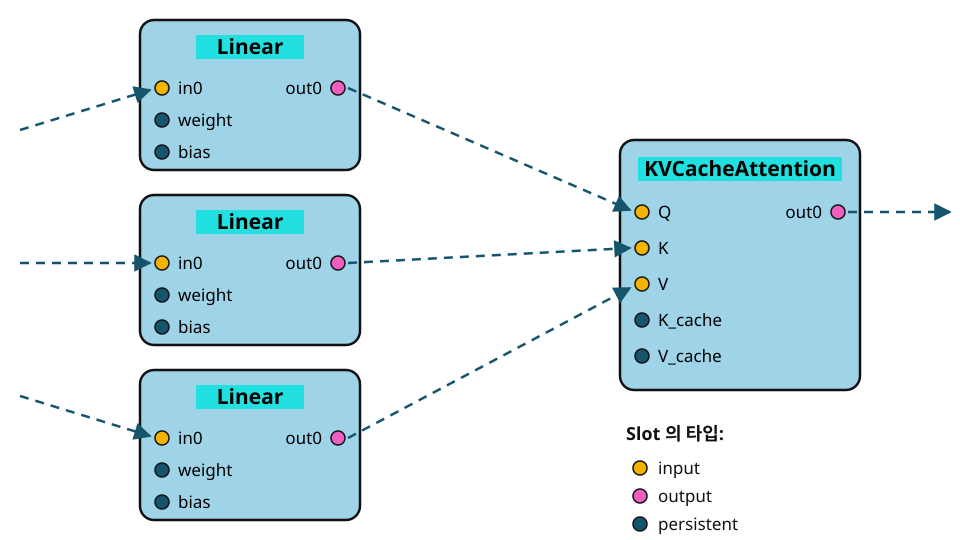

# Node



A node consist of named slots and one operation. It receives tensor through slots, performs the operation and outputs them through slots.

```cpp
vai::node::Linear linear({.inDim = inDim, .outDim = outDim});
vai::node::Attention attn({
    .numHeads          = numHeads,
    .kvCacheSize  = kvCacheSize,
    .headDim           = headDim,
    .numKVHeads        = numKVHeads,   // GQA: If omitted, it is the same as numHeads.
});
```

Each node defines its slots in the constructor. The two nodes in the above figure should be configured as follows:

```cpp
Linear::Linear(Config options)
: config_(options)
{
    addSlot("out0", NodeSlot::output);
    addSlot("in0", NodeSlot::input);
    addSlot("weight", NodeSlot::persistent);
    addSlot("partial", NodeSlot::temporary);   // Assigned only when in the reduce path.
    if (config_.hasBias) addSlot("bias", NodeSlot::persistent);

    // ... dtype determination, pipeline request
}
```

```cpp
Attention::Attention(Config options)
: config_(options)
{
    addSlot("out0", NodeSlot::output);
    addSlot("Q", NodeSlot::input);
    addSlot("K", NodeSlot::input);
    addSlot("V", NodeSlot::input);
    addSlot("K_cache", NodeSlot::persistent);
    addSlot("V_cache", NodeSlot::persistent);
    addSlot("partialO", NodeSlot::temporary);    // Assigned only when split-K partial sums and kCount > 1.
    addSlot("partialML", NodeSlot::temporary);

    // ... Calculate the number of GQA heads and prepare the cache buffer
}
```

Slot composition could vary depending on the options. The `bias` of `Linear` only exists when `hasBias` is enabled, and the `partial` not shown in the figure is an internal buffer that is not exposed externally.

## Slot

A slot is a port that tensors go in and out of. There are four types of slots, and depending on the type, the entity that provides the value differs.

| Type | The side that provides value(Tensor) | Value Lifetime |
|---|---|---|
| `input` | Output of the previous node or external input | Updated on each execution |
| `output` | The node itself (created in `prepare()` and filled by `run()` | Updated on each execution |
| `persistent` | User (weights) or node (cache, constant table) | Persistent throughout the network lifetime |
| `temporary` | The node itself | Valid only during `run()` |

### `input`

Receives the output of the previous node connected by the connection operator `-`. If it is the starting point of the graph, `NeuralNet` provides the external input.

### `output`

No action is required. The node calculates the shape and creates the tensor in `Node::prepare()`, and the result is stored in it after execution.

### `persistent`

A slot that retains the value between executions. There are two paths.

**1. The user provides the weights**: The slot where learned parameter values such as `weight` and `bias` of `Linear` are provided. If not provided, it will be caught during the shape validation in `Node::prepare()`.

```cpp
SafetensorsParser parser(VAI_DATA_DIR "/mnist/model.safetensors");
linear["weight"] = Tensor(parser["fc.weight"]);
linear["bias"]   = Tensor(parser["fc.bias"]);
```

**2. The rest will be prepared by the node itself**: This applies to `K_cache` and `V_cache` of `Attention` and `freqs` of `Rope`.

```cpp
// Attention::prepare(): The node creates the cache itself
(*this)["K_cache"] = Tensor({Hkv, config_.kvCacheSize, config_.headDim}, cacheDtype);
```

The common feature of `persistent` is that the buffer remains alive between executions, whether it is a fixed value such as weights or a state that accumulates at each step, such as a KV cache. `input`, `output`. The buffer is updated on each execution and reused from the buffer pool.

### `temporary`

Not exposed externally. As it is an intermediate buffer used only on a specific execution path, like `partial` of `Linear`, it is not allocated unless that path is taken.

## Slot handling

### Slot name

Slots are created only with `Node::addSlot` in the constructor. A new name cannot be assigned externally, and accessing a non-existent name results in an exception.

```cpp
linear.slot("weight");   // OK
linear.slot("gamma");    // Slot that does not exist in Linear (Exception)
```

Which slots are available can be found in the slot table of the [provided nodes](../06-nodes.md).

### Reading values and getting slots

`Node::operator[]` and `Node::slot()` have similar names, but they return different things.

```cpp
linear["out0"]       // Tensor&     Read and write the value
linear.slot("out0")  // NodeSlot&  Use it for connections
```

The connection operator `-` internally calls `slot()`. When handling values, use `[]`, and when connecting the graph, use `slot()`.

## Connection

The connection operator `-` connects the `output` slot of the left node to the `input` slot of the right node. Which slot to use is determined by specifying its name with `/`.

```cpp
conv/"out0" - "in0"/flatten/"out0" - "in0"/linear;
```

### Slot specification

The slot specification connection operator `/` specifies the `input` slot when attached to the left of a node and the `output` slot when attached to the right.
It is the same direction as the data flow from left to right.

```
          "in1" / add1 / "out0"
          └┬──┘          └─┬──┘
          input slot    output slot
```

If the slot specification connection operator `/` is omitted, `in0` will be used in front of the node, and the `out0` slot at the end of the node.

| Notation | `input` slot | `output` slot |
|---|---|---|
| `node` | `in0` | `out0` |
| `"X"/node` | **`X`** | `out0` |
| `node/"Y"` | `in0` | **`Y`** |
| `"X"/node/"Y"` | **`X`** | **`Y`** |

Therefore, the line above can be shortened as follows.

```cpp
conv - flatten - linear;
```

Only `input` type slots can be used with `/` in front of a node, and only `output` type slots can be used with `/` behind a node. `persistent` or `temporary` slots are not used for graph connections.

### When needed

Inputs are needed at each individual node. For example, `Add` needs to receive `in0` and `in1`, but with `-` alone, both inputs will be connected to `in0`, so the user needs to specify one side.

```cpp
input - norm1 - mhAttn - "in0"/add1;   // Attention results will go to the in0 of add1.
input                  - "in1"/add1;   // The original input will go to the in1 of add1.
```

This is a residual connection. When the output of `input` splits into two paths, it is allowed to connect one output to multiple inputs.

There are also nodes with completely different slot names. `Attention` receives `Q`, `K`, and `V`, so all of them need to be specified.

```cpp
input - toQ - splitQ - perQ - "Q"/attn - mergeOut - toOut;
input - toK - splitK - perK - "K"/attn;
input - toV - splitV - perV - "V"/attn;
```

## Node::prepare() and Node::run()

The lifecycle of a node consists of two stages. It is not called directly, but `NeuralNet` calls it instead.

|                      | When            | Tasks                  |
| -------------------- | ------------- | --------------------- |
| `Node::prepare()`    | When the input shape is determined | Verify the shape and create the output tensor  |
| `Node::run(cmdBuff)` | When recording the graph | Record GPU commands in the command buffer |

`Node::run()` records the command rather than executing the operation. The actual calculation occurs when the GPU executes the command later. This is why vAi does not go through the graph again for every inference. It creates the command once and reuses it.

When the input shape changes, it calls `Node::prepare()` again. Nodes with kernels that differ depending on the shape select the pipeline again at this point.
