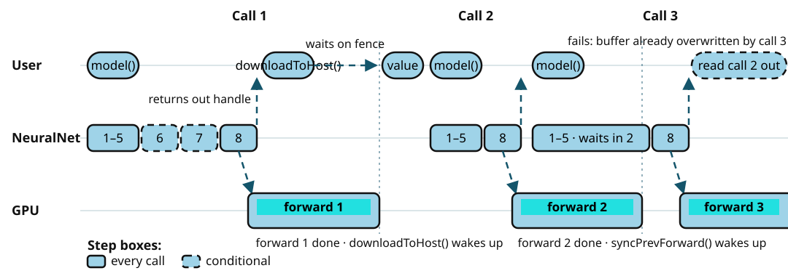

# 실행 파이프라인 요약

`model(inDict)` 한 줄, 즉 [`NeuralNet::operator()`](neural-net.md#실행) 안에서 일어나는 일입니다.

```text hl_lines="7 8"
model(inDict)
  1. 입력 검증과 대입
  2. 이전 forward 대기           syncPrevForward()
  3. 모델 훅                     onForwardBegin()
  4. 입력 업로드                  toPinned()
  5. 재기록 판정
  6. 그래프 준비 (최초 1회)        initialize()       ┐
  7. 커맨드버퍼 기록 (필요할 때)    recordCommands()   ┘ 매번 실행되지 않는다
  8. 제출 (비동기)
  9. 출력 반환
```



핵심은 **6번과 7번이 매번 실행되지 않는다는 것**입니다. 같은 형상과 버퍼가 유지되는 동안에는 이미 기록된 커맨드버퍼를 그대로 제출합니다. vAi가 매 추론마다 그래프를 다시 훑지 않는 이유입니다.

### 1. 입력 검증과 대입

넘겨받은 [`TensorDict`](neural-net.md#실행)의 키가 모델의 입력 노드 이름과 빠짐없이 일치하는지 확인한 뒤 각 텐서를 그 입력 노드의 슬롯에 대입합니다.

### 2. 이전 forward 대기

forward는 비동기로 실행되므로 직전 호출이 아직 GPU에서 수행 중일 수 있습니다. 이번 호출에서 호스트 가시 버퍼를 다시 사용하기 전에 [`syncPrevForward()`](neural-net.md#실행-밖에서-같은-값을-수정할-때)로 직전 forward의 완료를 기다립니다.

### 3. 모델 훅

[`NeuralNet::onForwardBegin()`](neural-net.md#onforwardbegin)을 호출합니다. 모델이 forward마다 갱신해야 할 상태가 있을 때 오버라이드하는 훅입니다. 예를 들어 llama3 샘플은 여기서 KV 캐시의 토큰 카운터와 샘플링 난수를 갱신합니다.

### 4. 입력 업로드

[호스트 데이터](tensor.md#상태) 상태의 입력 텐서를 pinned 버퍼(호스트 가시 디바이스 버퍼)로 복사합니다. GPU가 이 버퍼를 직접 읽으므로 VRAM으로 다시 전송하는 단계는 없습니다.

다른 forward의 출력처럼 이미 디바이스 버퍼를 가진 입력은 별도의 복사 없이 그대로 사용합니다(zero-copy).

### 5. 재기록 판정

입력 텐서의 형상과 버퍼가 현재 커맨드버퍼를 기록할 때 사용한 것과 같은지 확인합니다. 같다면 7번의 커맨드버퍼 기록을 통째로 건너뜁니다.

같은 입력 텐서를 계속 재사용하면 재기록은 일어나지 않습니다
([텐서의 외부 입력](tensor.md#2-외부-입력) 참조).

### 6. 그래프 준비 (최초 1회)

첫 forward에서만 실행됩니다. 그래프를 위상 정렬해 노드 실행 순서를 결정합니다. 사이클이 있으면 예외를 발생시킵니다. 이어서 각 노드의 [`Node::prepare()`](node.md#nodeprepare와-noderun)로 형상을 검증하고 가중치와 캐시가 담긴 [`persistent`](node.md#persistent) 슬롯의 텐서를 디바이스 버퍼에 올립니다.

업로드가 끝난 가중치의 **호스트 데이터는 이때 해제됩니다**. 같은 가중치가 호스트와 디바이스 양쪽에 중복으로 남는 일은 없습니다.

### 7. 커맨드버퍼 기록 (필요할 때)

위상 정렬된 순서대로 노드를 돌며 커맨드버퍼를 기록합니다. 노드마다 다음 순서로 진행합니다.

* `prepare()`로 입력 형상을 검증하고 출력 텐서를 만듭니다.
* [`output`](node.md#output), [`temporary`](node.md#temporary) 슬롯의 텐서에 버퍼 풀의 디바이스 버퍼를 할당하고 `output` 텐서를 연결된 다음 노드의 [`input`](node.md#input) 슬롯과 공유합니다.
* [`Node::run(cmdBuff)`](node.md#nodeprepare와-noderun)이 GPU가 수행할 명령을 커맨드버퍼에 **기록**합니다. 이 시점에 GPU 작업이 실행되는 것은 아닙니다.

기록이 끝난 노드의 비영속 텐서는 즉시 비워지고 사용하던 버퍼는 풀로 돌아갑니다. 뒤따르는 노드가 이 버퍼를 다시 쓸 수 있으므로 수명이 겹치지 않는 중간 텐서끼리 같은 메모리를 돌려씁니다.

### 8. 제출

완성된 커맨드버퍼, 즉 GPU가 수행할 작업을 순서대로 기록한 명령서를 GPU 작업 큐에 제출합니다. **`model(...)` 호출은 제출 후 바로 반환되며** GPU는 비동기로 작업을 이어 갑니다. 사용자는 GPU가 끝날 때까지 기다리지 않고 다음 일을 이어서 할 수 있습니다.

GPU 작업의 완료 여부는 fence로 추적합니다. 제출과 함께 걸어 둔 fence는 GPU가 커맨드버퍼의 실행을 마치면 신호 상태가 됩니다. 결과를 읽는 [`Tensor::downloadToHost()`](tensor.md#출력-읽기)가 필요할 때 이 fence를 기다립니다.

이번 제출은 직전 forward가 쓰던 출력 버퍼를 그대로 재사용합니다. 직전 출력을 아직 읽지 않았다면 새 forward가 그 버퍼를 덮어써서 이전 값이 사라집니다.

### 9. 출력 반환

출력 경계의 버퍼를 가리키는 텐서를 `TensorDict`에 담아 반환합니다. 이 시점에는 GPU가 아직 계산 중일 수 있습니다.

반환된 텐서는 **결과 자체라기보다 결과가 기록될 버퍼를 가리키는 핸들**입니다. 실제 값을 호스트에서 쓸 때 `Tensor::downloadToHost()`를 호출하면 필요할 때 fence를 기다렸다가 데이터를 가져옵니다
([텐서의 출력 읽기](tensor.md#출력-읽기) 참조).
